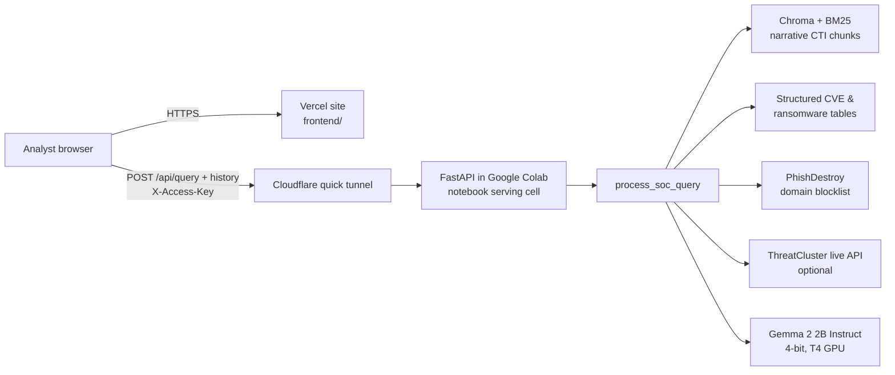

# CTI RAG Assistant v2.0

A refreshable, multi-source **Cyber Threat Intelligence (CTI) Retrieval-Augmented Generation assistant** for multi-turn CTI research and preliminary phishing-email triage. Built for CP5403 Assessment 2 (Pathway A: RAG).

- **Base model (unchanged):** `google/gemma-2-2b-it`, 4-bit NF4 (`bitsandbytes`), greedy decoding
- **Retrieval:** ChromaDB semantic search + BM25 keyword search (hybrid), plus structured CVE / ransomware lookups and exact domain matching against a phishing blocklist
- **Embeddings:** `sentence-transformers/all-MiniLM-L6-v2`
- **Interfaces:** Gradio (inside the notebook) and a Vercel-hosted React + TypeScript web front end (with Light/Dark theme toggle, multi-turn follow-up chat, built-in email triage samples, and a live dataset citation sidebar)

## Architecture



Vercel hosts only the static user interface. Because Gemma 2 2B requires a CUDA GPU, the language model and hybrid retrieval pipeline run in Google Colab and are exposed securely via a temporary Cloudflare tunnel (`trycloudflare.com`). The browser authenticates with the Colab API using a session access key (`X-Access-Key`); Hugging Face and ThreatCluster API keys stay strictly inside Colab Secrets and never reach the browser.

## Repository structure

| Path | Contents |
|---|---|
| `notebook/CTI_RAG_Assistant.ipynb` | Full Colab pipeline: data loading, chunking, hybrid Chroma + BM25 vector store, Gemma 2 2B IT, evidence-bound prompts, evaluation suite, Gradio app, and FastAPI serving cell |
| `frontend/` | Vite + React + TypeScript web interface deployed on Vercel (Light/Dark theme, CTI follow-up chat, Email Triage with sample payloads, live citation sidebar) |
| `evaluation/` | Benchmark question set (`eval_questions.json`) and end-to-end API evaluation script (`run_api_evaluation.py`) |
| `requirements.txt` | Python dependencies used by the notebook and evaluation script |
| `vercel.json` | Vercel build and SPA routing settings (builds `frontend/`) |

## Key capabilities

1. **Multi-turn CTI Research & Follow-Up Chat:** Analysts can ask an initial CTI question and ask follow-up questions in the same investigation thread (for example, requesting a similar real-world case study, specific CVEs/IOCs, or step-by-step remediation). Recent turns are sent in the `history` array to resolve context while keeping every factual claim strictly bound to retrieved records.
2. **Organized, Simple, and Cited Answers:** Every CTI response is structured into a clear plain-language summary, a concrete case study scenario, step-by-step mitigations, and inline dataset citation badges (`[S#]`, `[C#]`, `[V#]`, `[R#]`, `[L#]`) mapped to exact dataset names and links.
3. **Preliminary Phishing Email Triage:** Inspects sender/reply-to mismatches, urgency cues, and URLs, checks extracted domains against the PhishDestroy blocklist (and optionally the ThreatCluster API via domain-only lookup without transmitting raw email text), and includes one-click sample emails for testing.

## Running the backend in Google Colab

1. Open `notebook/CTI_RAG_Assistant.ipynb` in Google Colab.
2. Select **Runtime → Change runtime type → T4 GPU**.
3. Open **Secrets** (key icon in the left sidebar), add the following keys, and toggle notebook access on:
   - `HF_TOKEN`: A Hugging Face read token (accept the Gemma 2 licence at <https://huggingface.co/google/gemma-2-2b-it> first).
   - `THREATCLUSTER_API_KEY` *(optional)*: Enables live ThreatCluster enrichment.
   - `CTI_ACCESS_KEY` *(optional)*: A fixed access key for the website. If omitted, a random key is generated automatically on each run.
4. Select **Runtime → Run all**. The final serving cell verifies external Cloudflare DNS propagation, starts a keep-alive loop, and prints:
   ```text
   Backend URL : https://<random-words>.trycloudflare.com
   Access key  : <key>
   ```
5. Leave the Colab tab open while using the website. The tunnel URL changes on every run and stops when the Colab runtime disconnects.

## Deploying the front end on Vercel

1. In Vercel, select **Add New → Project → Import** your GitHub repository.
2. Leave the **Root Directory** as the repository root; `vercel.json` already configures the install command, build command, and output directory (`frontend/dist`).
3. Click **Deploy**. Every push to `main` redeploys automatically.
4. Open the deployed site, paste the **Backend URL** and **Access key** printed by Colab into the top connection card, and click **Save & test**. Both values are saved locally in your browser (`localStorage`).

### Local front-end development

```bash
cd frontend
npm install
npm run dev        # Starts dev server at http://localhost:5173
npm run build      # Runs TypeScript type-check and production Vite build
```

## API

| Method | Path | Body | Returns |
|---|---|---|---|
| `GET` | `/api/health` | – | Model ID, indexed vector chunk count, CVE count, and server UTC timestamp |
| `POST` | `/api/query` | `{"question": str, "mode": "cti" \| "email", "use_live_api": bool, "history": [{"role": "user" \| "assistant", "content": str}]}` | `answer_markdown`, `sources_markdown`, and `timings` |
| `POST` | `/api/compare` | `{"question": str, "use_live_api": bool}` | `base_gemma_answer`, `rag_answer`, and `rag_sources` |

All endpoints require the `X-Access-Key` header. Requests are serialized via a thread lock (`_gpu_lock`) to avoid T4 GPU contention.

## Evaluation

- **Notebook — “Evaluation & Testing”:** Records retrieval latency, Gemma generation latency, and total latency for historical, vulnerability, and ransomware queries (`cti_multisource_evaluation_results.csv`).
- **Notebook — “Extended Evaluation: RAG vs. No-Retrieval Baseline”:** Evaluates the same `google/gemma-2-2b-it` model with and without retrieval (ablation study) across six question categories, including an out-of-scope question that must be refused (`cti_rag_vs_baseline_evaluation.csv`).
- **End-to-end API evaluation through the live Cloudflare tunnel:**
  ```bash
  pip install -r requirements.txt
  python evaluation/run_api_evaluation.py --backend https://<your-tunnel>.trycloudflare.com --key <your-access-key>
  ```
  Writes `evaluation/results/api_evaluation_results.csv` with round-trip latency, server latency, network overhead, citation counts, and abstention checks.

Correctness, grounding, and relevance (0–2 scale each) are scored manually by checking every claim against the cited records.

## Data sources & citation tags

| Tag | Source | Use | Licence |
|---|---|---|---|
| `[C#]` | [threatcluster/threat-incident-clusters](https://huggingface.co/datasets/threatcluster/threat-incident-clusters) | Incident summaries, entities, dates | CC BY 4.0 |
| `[V#]` | [threatcluster/cve-exploitation-signals](https://huggingface.co/datasets/threatcluster/cve-exploitation-signals) | CVE, CVSS, CISA KEV, exploit fields (structured lookup) | CC BY 4.0 |
| `[R#]` | [threatcluster/ransomware-leak-site-victims](https://huggingface.co/datasets/threatcluster/ransomware-leak-site-victims) | Ransomware group leak-site claims (structured lookup) | CC BY 4.0 |
| `[S#]` | [reloading0101/threat-intelligence-dataset](https://huggingface.co/datasets/reloading0101/threat-intelligence-dataset) | Curated CTI Q&A | CC BY-NC-SA 4.0 |
| `[S#]` | [guychuk/cyber-threat-intelligence-reports](https://huggingface.co/datasets/guychuk/cyber-threat-intelligence-reports) | Historical CTI report archive | See dataset card |
| – | [phishdestroy/destroylist](https://huggingface.co/datasets/phishdestroy/destroylist) | Exact domain blocklist for email triage | See dataset card |
| `[L#]` | [ThreatCluster REST API](https://threatcluster.io/about/api-reference) | Optional live incident/entity search | ThreatCluster terms |

## Limitations

- **Analyst decision support only:** Not a malware sandbox, secure email gateway, or autonomous incident response tool.
- **Blocklist coverage:** A blocklist match is an investigative lead; a non-match does not guarantee an email is safe.
- **Unverified leak-site claims:** Ransomware leak-site entries represent threat-actor claims rather than independently confirmed breaches.
- **Static dataset snapshots:** Local Hugging Face datasets are periodic snapshots rather than real-time telemetry; publisher-generated summaries require analyst corroboration.
- **Decoding trade-offs:** Greedy decoding ensures reproducible outputs for evaluation but does not eliminate all reasoning errors.
- **Ephemeral Colab hosting:** Free Google Colab runtimes disconnect after idle or maximum session limits, generating a new Cloudflare tunnel URL on each restart.

## Declaration of AI-generated material

In accordance with CP5403 academic integrity requirements, generative AI tools were used during development as follows:

- **Tools used:** Google Gemini (web assistant)
- **Purpose:** Assisting with React/TypeScript UI components (`frontend/src/`), FastAPI/Cloudflare tunnel integration, end-to-end API evaluation script formatting, and README structure.
- **Verification & human oversight:** All retrieval pipelines, prompt guardrails, dataset schemas, API endpoints, and evaluation outputs were independently tested in Google Colab and manually verified against source records by the author.