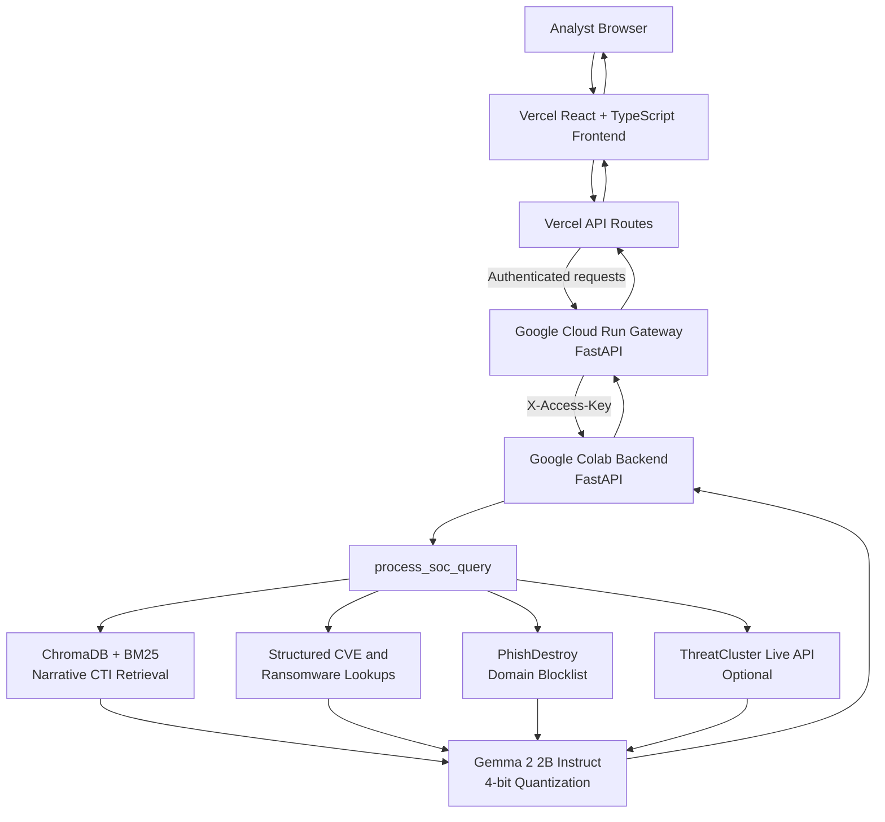

# CTI RAG Assistant v2.0

A multi-source **Cyber Threat Intelligence (CTI) Retrieval-Augmented Generation assistant** designed for multi-turn CTI research and preliminary phishing-email triage. Developed for CP5403 Assessment 2 (Pathway A: RAG).

The project combines semantic and keyword-based retrieval, structured threat intelligence lookups, and evidence-grounded language generation to help analysts investigate cybersecurity threats using curated CTI datasets.

## Technology Stack

- **Base model:** `google/gemma-2-2b-it`, 4-bit NF4 quantization using `bitsandbytes`, with greedy decoding.
- **Retrieval:** ChromaDB semantic search + BM25 keyword search (hybrid retrieval), with structured CVE and ransomware lookups and exact domain matching against a phishing blocklist.
- **Embeddings:** `sentence-transformers/all-MiniLM-L6-v2`.
- **Language model hosting:** Google Colab with a CUDA-enabled GPU.
- **Backend gateway:** FastAPI deployed on Google Cloud Run.
- **Frontend:** Vercel-hosted React + TypeScript application built with Vite.
- **Additional interface:** Gradio inside the Google Colab notebook.

The web interface supports CTI follow-up conversations, email triage samples, light/dark themes, and a dataset citation panel.

## Architecture



### Architecture Overview

The system separates the user interface, gateway, and AI processing backend:

1. **Vercel:** Hosts the React and TypeScript frontend and the project's API routes.
2. **Google Cloud Run:** Runs the FastAPI gateway. It authenticates incoming requests and forwards them to the Colab backend.
3. **Google Colab:** Hosts the Gemma model, hybrid retrieval pipeline, structured CTI lookups, and API serving endpoints.
4. **ChromaDB and BM25:** Retrieve relevant narrative CTI records using semantic and keyword-based search.
5. **External data services:** Hugging Face datasets provide the main CTI knowledge sources, while the ThreatCluster API can optionally provide live enrichment.

The gateway uses environment variables to authenticate requests and communicate with the Colab backend. API credentials should remain in server-side environment variables or Colab Secrets and must never be exposed in frontend source code.

## Repository Structure

| Path | Contents |
|---|---|
| `notebook/CTI_RAG_Assistant.ipynb` | Google Colab pipeline: dataset loading, preprocessing, chunking, hybrid retrieval, Gemma inference, evaluation, Gradio interface, and FastAPI serving |
| `frontend/` | Vite + React + TypeScript web application |
| `frontend/src/` | Frontend application components and interface logic |
| `api/cti/health.js` | Vercel API route for backend health checks |
| `api/cti/query.js` | Vercel API route for CTI and email-triage requests |
| `cloud-run-gateway/main.py` | FastAPI gateway for authentication and forwarding requests to Colab |
| `cloud-run-gateway/Dockerfile` | Container configuration for Cloud Run |
| `cloud-run-gateway/requirements.txt` | Gateway-specific Python dependencies |
| `evaluation/` | Evaluation questions and API evaluation scripts |
| `requirements.txt` | Python dependencies used by the notebook and evaluation |
| `vercel.json` | Vercel build and SPA routing configuration |

## Key Capabilities

### 1. Multi-turn CTI Research and Follow-up Chat

Analysts can ask an initial CTI question and continue the investigation through follow-up questions.

Examples include:

- Explaining a cybersecurity threat in simple language.
- Investigating a particular CVE.
- Finding documented real-world attack cases.
- Identifying relevant indicators of compromise (IOCs).
- Requesting defensive recommendations and mitigation steps.

Conversation history is passed through the `history` field to help maintain context across related questions.

### 2. Multi-source Evidence Retrieval

The assistant uses multiple CTI sources, including:

- Historical cyber threat intelligence reports.
- Threat incident summaries.
- CVE exploitation signals.
- Ransomware leak-site victim records.
- Curated CTI question-and-answer records.
- Phishing-domain blocklist data.
- Optional live ThreatCluster API enrichment.

The retrieval pipeline combines semantic and keyword search with structured lookups where applicable.

### 3. Evidence-grounded Answers and Citations

The assistant is designed to generate answers grounded in retrieved CTI records.

Citation identifiers such as `[S#]`, `[C#]`, `[V#]`, `[R#]`, and `[L#]` identify the corresponding retrieved sources.

When the selected datasets do not contain sufficient supporting evidence, the assistant should clearly communicate the limitation rather than inventing facts.

The answer format should suit the question: simple questions should receive concise explanations, while complex investigation questions may require more detailed case studies and defensive recommendations.

### 4. Preliminary Phishing Email Triage

The email-triage feature examines suspicious email characteristics, including:

- Sender and Reply-To mismatches.
- Suspicious URLs and extracted domains.
- Urgency and social-engineering language.
- Exact domain matches against the PhishDestroy blocklist.
- Optional ThreatCluster domain enrichment.

The optional ThreatCluster integration uses domain-based lookup rather than transmitting the complete raw email text.

The feature provides preliminary investigative guidance and does not replace a secure email gateway or a full malware analysis environment.

## Running the Backend in Google Colab

1. Open `notebook/CTI_RAG_Assistant.ipynb` in Google Colab.
2. Select **Runtime → Change runtime type** and choose a CUDA-enabled GPU, such as T4 when available.
3. Open **Secrets** using the key icon in the left sidebar.
4. Add the required secrets:

| Secret | Purpose |
|---|---|
| `HF_TOKEN` | Hugging Face read token. Accept the Gemma 2 model licence before downloading the model. |
| `THREATCLUSTER_API_KEY` | Optional API key for live ThreatCluster enrichment. |
| `CTI_ACCESS_KEY` | Backend access key used to authenticate gateway requests. |

5. Enable notebook access to the required secrets.
6. Select **Runtime → Run all**.
7. Wait for the model, datasets, vector store, and API server to initialize.
8. Keep the Colab runtime active while using the application.

**Important:** The Colab backend must remain available for the Cloud Run gateway to forward requests successfully. If the runtime disconnects or restarts, the backend URL and access configuration may need to be updated.

## Deploying the Gateway on Google Cloud Run

The gateway source code is located in `cloud-run-gateway/`.

### Required environment variables

Configure the following environment variables in Cloud Run:

| Variable | Purpose |
|---|---|
| `COLAB_BACKEND_URL` | Base URL of the running Colab backend |
| `COLAB_ACCESS_KEY` | Access key used by the gateway to authenticate with Colab |
| `GATEWAY_API_KEY` | Secret key used to authenticate incoming gateway requests |

Do not commit actual API keys, access tokens, or secrets to GitHub.

### Gateway endpoints

| Method | Path | Purpose |
|---|---|---|
| `GET` | `/healthz` | Checks whether the gateway service is running |
| `GET` | `/api/health` | Authenticated health request forwarded to Colab |
| `POST` | `/api/query` | Authenticated query request forwarded to Colab |

The gateway checks the incoming `X-Gateway-Key` header and forwards requests to the Colab backend using the `X-Access-Key` header.

The Cloud Run service should be configured with the appropriate environment variables and deployment permissions before connecting the frontend.

## Deploying the Frontend on Vercel

1. Open Vercel and select **Add New → Project**.
2. Import the GitHub repository.
3. Keep the repository root as the project root if using the supplied `vercel.json`.
4. Verify that the build command and output directory are configured correctly.
5. Add the required server-side environment variables for the Vercel API routes and Cloud Run connection, using the names expected by the current API route implementation.
6. Deploy the project.
7. Open the deployed website and verify that the backend connection and health check work.

Every push to the configured production branch can trigger a new deployment.

**Security note:** Gateway credentials must be handled by server-side API routes. Do not place private API keys directly in React components or expose them through `VITE_` environment variables.

### Local Frontend Development

```bash
cd frontend

npm install

npm run dev
```

The local development server normally runs at:

```text
http://localhost:5173
```

Build the frontend for production:

```bash
npm run build
```

## API

### Gateway API

| Method | Path | Request | Description |
|---|---|---|---|
| `GET` | `/healthz` | No body | Gateway liveness check |
| `GET` | `/api/health` | `X-Gateway-Key` header | Forwards a health request to Colab |
| `POST` | `/api/query` | JSON body + `X-Gateway-Key` header | Forwards a CTI or email-triage query to Colab |

### Colab Backend API

| Method | Path | Request | Description |
|---|---|---|---|
| `GET` | `/api/health` | `X-Access-Key` header | Returns backend health information |
| `POST` | `/api/query` | JSON body + `X-Access-Key` header | Processes CTI research or email-triage requests |

Example query payload:

```json
{
  "question": "What is phishing?",
  "mode": "cti",
  "use_live_api": false,
  "history": []
}
```

The query response is designed to include:

- `answer_markdown`
- `sources_markdown`
- `timings`

The exact response fields depend on the active backend implementation.

## Evaluation

The project includes evaluation components for examining retrieval performance, response quality, and API performance.

### Notebook Evaluation

The notebook evaluation covers:

- Retrieval latency.
- Gemma generation latency.
- Total response latency.
- Historical CTI questions.
- Vulnerability-related questions.
- Ransomware-related questions.

### RAG versus No-Retrieval Baseline

The comparison evaluates the same base model with and without retrieval to examine the contribution of retrieved evidence.

The evaluation should consider:

- Answer correctness.
- Evidence grounding.
- Citation validity.
- Relevance.
- Appropriate abstention when supporting evidence is unavailable.

### End-to-end API Evaluation

Where the evaluation script and backend endpoints are configured, run:

```bash
pip install -r requirements.txt

python evaluation/run_api_evaluation.py \
  --backend https://<your-backend-url> \
  --key <your-access-key>
```

The script is intended to measure API response latency, citation counts, and abstention behavior. Confirm that its expected endpoint and authentication format match the current deployment before running it.

## Data Sources and Citation Tags

| Tag | Source | Purpose | Licence / Terms |
|---|---|---|---|
| `[C#]` | [ThreatCluster Incident Clusters](https://huggingface.co/datasets/threatcluster/threat-incident-clusters) | Incident summaries, entities, and dates | CC BY 4.0 |
| `[V#]` | [ThreatCluster CVE Exploitation Signals](https://huggingface.co/datasets/threatcluster/cve-exploitation-signals) | CVE, CVSS, CISA KEV, and exploitation fields | CC BY 4.0 |
| `[R#]` | [ThreatCluster Ransomware Leak-Site Victims](https://huggingface.co/datasets/threatcluster/ransomware-leak-site-victims) | Ransomware group leak-site claims | CC BY 4.0 |
| `[S#]` | [Reloading0101 Threat Intelligence Dataset](https://huggingface.co/datasets/reloading0101/threat-intelligence-dataset) | Curated CTI question-and-answer records | CC BY-NC-SA 4.0 |
| `[S#]` | [Cyber Threat Intelligence Reports](https://huggingface.co/datasets/guychuk/cyber-threat-intelligence-reports) | Historical CTI report archive | See dataset card |
| — | [PhishDestroy Destroylist](https://huggingface.co/datasets/phishdestroy/destroylist) | Phishing-domain blocklist for email triage | See dataset card |
| `[L#]` | [ThreatCluster API](https://threatcluster.io/about/api-reference) | Optional live incident and entity enrichment | ThreatCluster terms |

Refer to the individual dataset cards and API terms for current licensing, attribution, and usage requirements.

## Limitations

- **Analyst decision support only:** This application is not a malware sandbox, secure email gateway, or autonomous incident-response platform.
- **Evidence availability:** Retrieval quality depends on the datasets loaded, indexed, and available during execution.
- **Blocklist coverage:** A blocklist match is an investigative lead. A non-match does not guarantee that an email or domain is safe.
- **Unverified leak-site claims:** Ransomware leak-site entries represent threat-actor claims and should not automatically be treated as independently verified breaches.
- **Static dataset snapshots:** Hugging Face datasets are snapshots and may not contain the latest threat intelligence.
- **Model limitations:** Gemma may produce reasoning or interpretation errors. Generated answers require analyst verification against the cited records.
- **Decoding trade-offs:** Greedy decoding supports reproducibility but does not eliminate hallucinations or factual errors.
- **Colab availability:** Colab runtimes can disconnect after idle or maximum session limits. The backend must be restarted and the gateway configuration checked when this happens.
- **Preliminary email analysis:** Email triage does not replace sandbox analysis, SPF/DKIM/DMARC verification, or a full incident investigation.

## Declaration of AI-generated Material

In accordance with CP5403 academic integrity requirements, generative AI tools were used during project development.

- **Tools used:** Google Gemini and ChatGPT.
- **Purpose:** Assistance with React/TypeScript interface development, FastAPI and gateway integration, documentation, debugging, and evaluation-script formatting.
- **Verification and human oversight:** The author is responsible for reviewing the implementation, checking dataset schemas, testing API behavior, and verifying generated CTI claims against their cited source records.

All AI-assisted development work should be reviewed and accurately disclosed in accordance with the university's academic integrity requirements.
